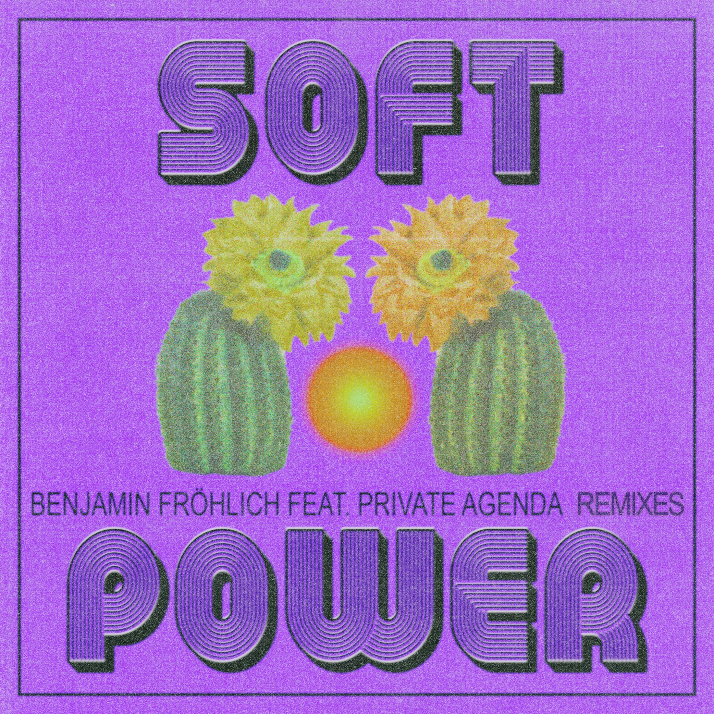

Soft Power is a collaboration we delicately crafted with producer and DJ Benjamin Fröhlich, released on Permanent Vacation, one of our very favourite labels. Paul Carr expertly produced our vocal takes.

In May 2023, a collection of remixes took the indie-pop original to the centre of the dance floor, with versions from Lea Lisa, Aroop Roy, Iron Curtis and SIRS. The Disco Dub also features on Permanent Vacation's Selected Label Works 10 compilation.

We teamed up with Benjamin again in 2025, remixing his track [Attraction](/discography/benjamin-frohlich-attraction-private-agenda-spa-treatment/).
